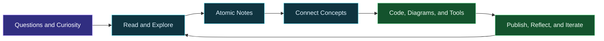
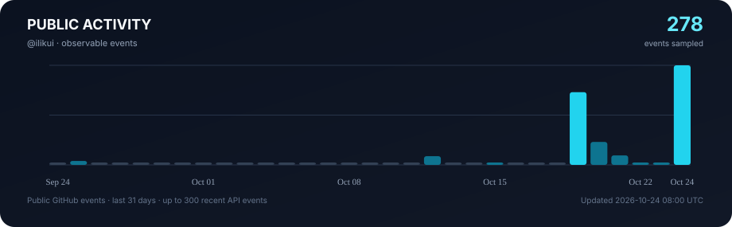

<h1>Hi, I'm Li Kui</h1>

<strong>Automotive Software & Embedded Engineering · Knowledge Engineering · Open Source</strong>

I break down complex problems, connect scattered ideas, and turn what I learn into working projects.

  
  
  
  

  
  
  

---

## About Me

I work at the intersection of **engineering practice and knowledge systems**. I explore automotive electronics, embedded software, and developer tools while turning what I learn into searchable, reusable, and continuously improving knowledge.

- **Automotive & Embedded Systems:** Classic AUTOSAR, in-vehicle communication, diagnostics, embedded C, and MCU software.
- **Knowledge Engineering:** Digital gardens, Zettelkasten, progressive reading, spaced repetition, and knowledge graphs.
- **Development & Automation:** Practical tools, engineering examples, documentation systems, CI/CD, and automated workflows.
- **Open Source & Lifelong Learning:** Turning problems, solutions, and hands-on experience into tutorials, diagrams, and runnable projects.

> My goal is not simply to record what I have learned, but to make knowledge discoverable, understandable, verifiable, and useful for creating things.

## Selected Projects

<table>
  <tr>
    <td width="50%" valign="top">
      <h3>🚘 AutomaticDriving</h3>
      
A structured learning path for autonomous driving, bringing together core concepts and high-quality resources to map the journey from perception to planning and control.

      
    </td>
    <td width="50%" valign="top">
      <h3>🌱 NotesBook</h3>
      
A digital garden and knowledge organization project connecting reading, topic notes, concept links, and continuous learning.

      
    </td>
  </tr>
  <tr>
    <td width="50%" valign="top">
      <h3>🗂️ Memo</h3>
      
A learning tool built around flashcards and spaced repetition, exploring how knowledge can move from being seen to being remembered, understood, and applied.

      
    </td>
    <td width="50%" valign="top">
      <h3>🧰 Programming Learning Repositories</h3>
      
Step-by-step tutorials with code examples, exercises, and diagrams designed to build reusable programming fundamentals.

      
      
      
      
    </td>
  </tr>
</table>

## Digital Spaces

<table>
  <thead>
    <tr><th>Space</th><th>Purpose</th><th>Explore</th></tr>
  </thead>
  <tbody>
    <tr><td>🌐 Personal Website</td><td>Projects, technical spaces, and books, films, and music</td><td><a href="https://likui.info/">likui.info</a></td></tr>
    <tr><td>🧭 Technical Spaces</td><td>Learning hubs organized by technology and subject</td><td><a href="https://likui.info/#spaces">Explore spaces →</a></td></tr>
    <tr><td>👋 About</td><td>Personal introduction and content directory</td><td><a href="https://about.likui.info/">about.likui.info</a></td></tr>
    <tr><td>🌱 Digital Garden</td><td>Long-form notes, topic collections, and linked concepts</td><td><a href="https://wiki.likui.info/">wiki.likui.info</a></td></tr>
    <tr><td>💬 Memos</td><td>Capturing ideas, short notes, and everyday observations</td><td><a href="https://blog.zzek.cn/memos/">Open Memos →</a></td></tr>
    <tr><td>🧑‍💻 GitHub</td><td>Source code, learning projects, and open-source experiments</td><td><a href="https://github.com/ilikui?tab=repositories">All repositories →</a></td></tr>
  </tbody>
</table>

## From Ideas to Work

I believe meaningful learning is more than accumulating information. It is a continuous cycle: **ask questions → understand principles → connect ideas → test in practice → share and reuse**.

## Toolbox

**Automotive & Embedded**

**Software, Knowledge & Automation**

## GitHub Activity

  
  

  
  Generated automatically by GitHub Actions from public GitHub events. It does not represent a complete count of private contributions.

  
<strong>Contribution Calendar</strong>

  
  
<strong>Contribution Snake · GitHub Actions</strong>

  <picture>
    <source media="(prefers-color-scheme: dark)" srcset="https://raw.githubusercontent.com/ilikui/ilikui/output/github-contribution-grid-snake-dark.svg">
    <source media="(prefers-color-scheme: light)" srcset="https://raw.githubusercontent.com/ilikui/ilikui/output/github-contribution-grid-snake.svg">
    
  </picture>

---

### Stay Curious. Build with Care. Keep Connecting.

Build small. Think deeply. Connect ideas.

Code is a tool; projects are a form of expression. Let every learning experience become the starting point for the next creation.

